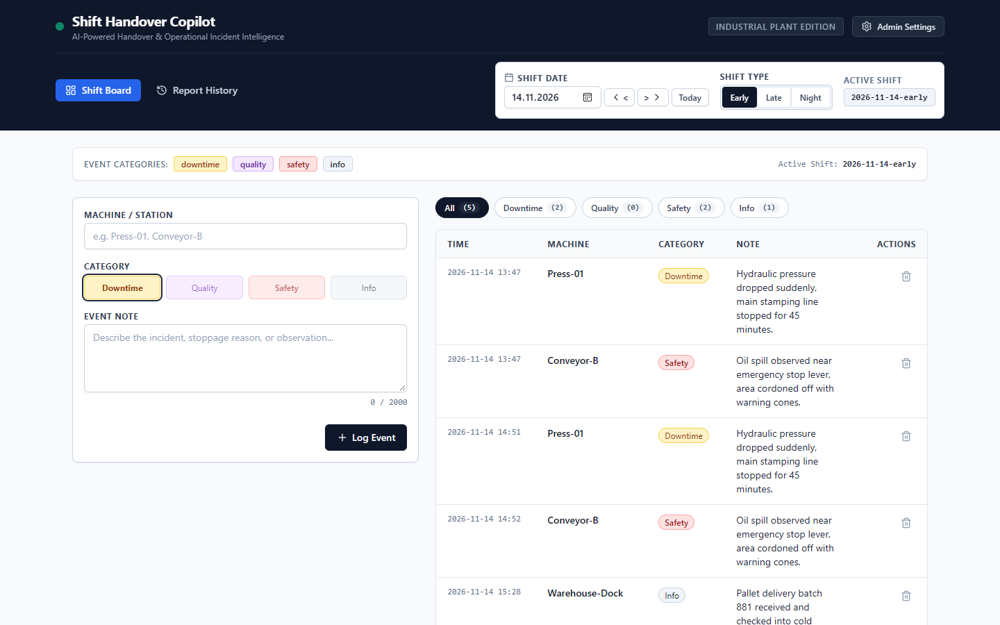
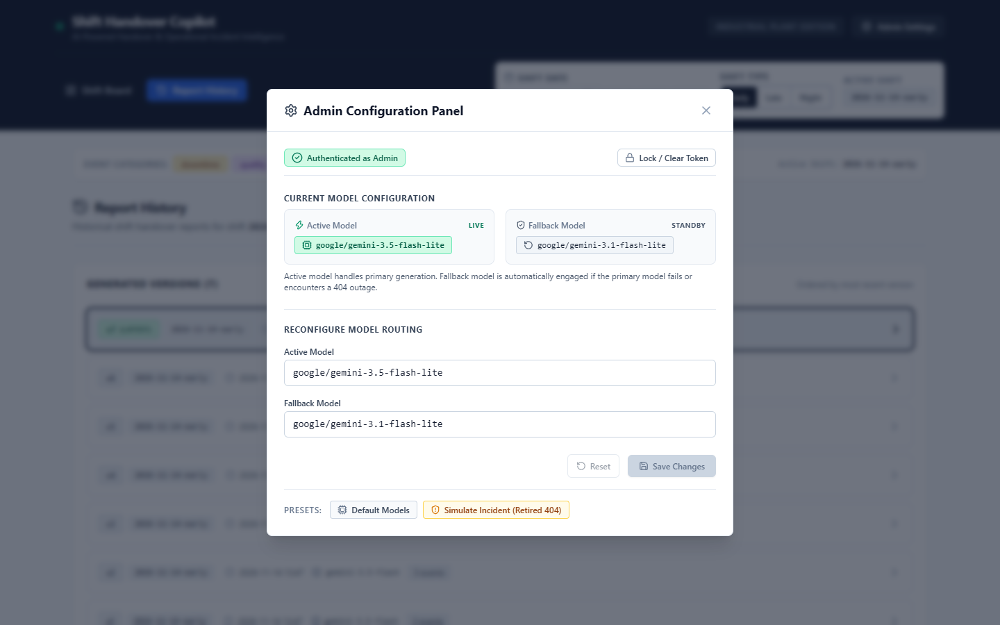
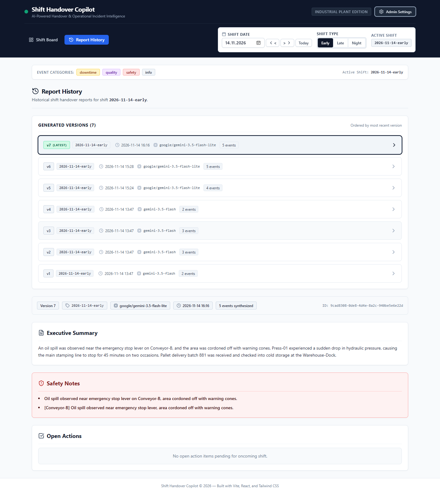
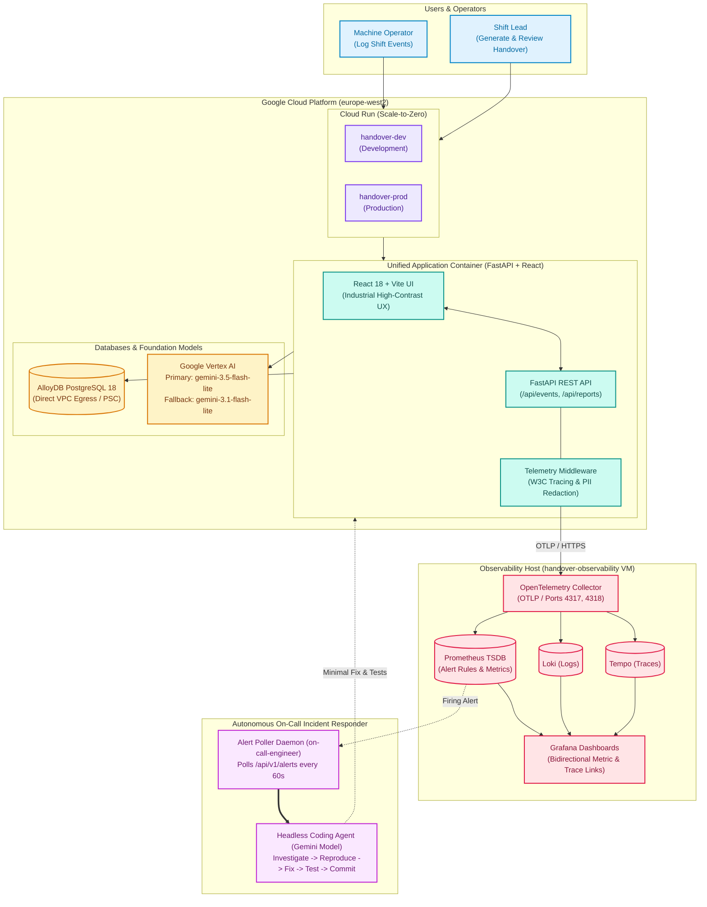
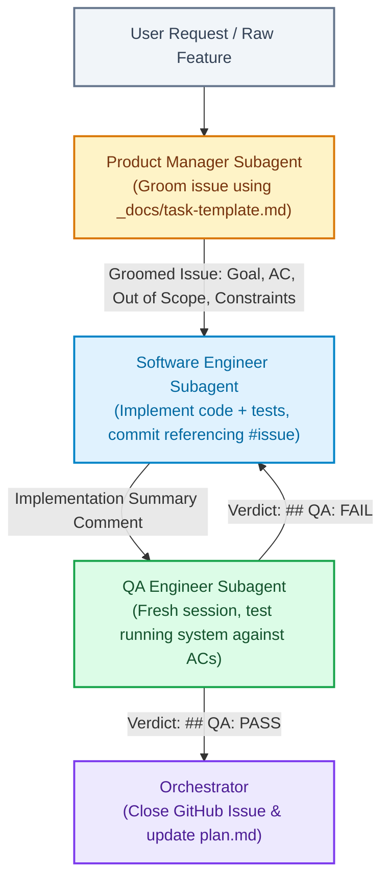

# Shift Handover Copilot

> **An autonomous, production-grade shift handover copilot for manufacturing plants.**  
> Operators log structured shift events, Google Gemini synthesizes an actionable handover report with automatic fallback, OpenTelemetry provides correlated telemetry, and an autonomous on-call agent monitors alerts and resolves incidents.

[](https://github.com/gxobst/handover-copilot/actions/workflows/gcp-pipeline.yml)
[](https://github.com/gxobst/handover-copilot/actions/workflows/promote-prod.yml)
[](file:///E:/Project/AI%20Dev%20Tools%20Zoomcamp/shift-handover-copilot/backend/tests)
[](file:///E:/Project/AI%20Dev%20Tools%20Zoomcamp/shift-handover-copilot/frontend)
[](https://opentelemetry.io/)
[](https://cloud.google.com/)
[](https://www.python.org/)
[](https://react.dev/)
[](LICENSE)

---

## ⚡ 5-Minute Reviewer Path

> [!TIP]
> **Zero Idle Cost Architecture:** Both Dev and Prod environments run on Google Cloud Run configured with `min-instances=0`. If waking up after idle dormancy, the very first request may take ~15s while the Cloud Run instance and AlloyDB connection pool initialize. Subsequent requests respond in sub-second latency.

If you are evaluating this repository, start here:

1. **Live Production App:** [https://handover-prod-532827973195.europe-west2.run.app](https://handover-prod-532827973195.europe-west2.run.app)
   - Select date `2026-11-14` and shift `early` (or `night`).
   - Click **Generate Handover** to view structured synthesis: Summary, Open Actions, and Safety Notes.
2. **Live Development App:** [https://handover-dev-532827973195.europe-west2.run.app](https://handover-dev-532827973195.europe-west2.run.app)
3. **Live Grafana Observability Dashboard:** [http://34.153.185.34:3000/d/handover-app-metrics/shift-handover-application-metrics](http://34.153.185.34:3000/d/handover-app-metrics/shift-handover-application-metrics)
   - Filter by `$environment` (`dev` / `prod`) and `$version`.
   - Inspect correlated metrics, traces, and logs.
4. **Live Prometheus Alert Rules:** [http://34.153.185.34:9090/api/v1/rules](http://34.153.185.34:9090/api/v1/rules)
   - User-impact alerting (`HandoverGenerationFailureRateHigh` and `HandoverHttpErrorRateHigh`).
5. **Autonomous Agent Evidence:** Browse [Closed GitHub Issues](https://github.com/gxobst/handover-copilot/issues?q=is%3Aissue+is%3Aclosed)
   - Every feature was autonomously specified by a **Product Manager**, implemented by a **Software Engineer**, and verified with an independent `## QA: PASS` verdict by a **QA Engineer**.

---

## 📖 What is this Project?

> [!NOTE]
> **Deterministic Offline Development:** The entire application and all 238 backend tests can run 100% offline with zero cloud credentials by setting `LLM_BACKEND=fake` and using local SQLite.

### The Problem
During shift transitions in manufacturing plants (early, late, and night shifts), outgoing operators routinely communicate equipment status, safety events, and quality checks through fragmented paper logs, whiteboard notes, or quick verbal handovers. Critical context gets dropped:
- Maintenance actions are forgotten or unassigned.
- Safety interlocks and warning trips are missed by the incoming crew.
- Shift leads start their shifts blind, spending the first 45 minutes piecing together what happened.

### What We Built
**Shift Handover Copilot** is a specialized, production-ready manufacturing tool designed for zero-idle cost and maximum operational reliability:
1. **Real-time Shift Event Logging:** Operators log machine events (`downtime`, `quality`, `safety`, `info`) throughout the shift.
2. **Deterministic & Resilient GenAI Synthesis:** Outgoing shift leads trigger handover generation powered by Google Gemini (`gemini-3.5-flash-lite`). If the primary model fails or experiences upstream throttling, the backend automatically fails over to `gemini-3.1-flash-lite`, ensuring reports are always generated within 15 seconds.
3. **Complete Observability as Code:** OpenTelemetry instrumented with full W3C trace propagation, structured JSON logging, and metric dimensions, paired with a dedicated Prometheus, Loki, Tempo, and Grafana stack.
4. **Actionable User-Impact Alerting:** Alerts trigger on actual user pain (e.g. report generation failure rate > 20%), not arbitrary server CPU spikes.
5. **Autonomous On-Call Responder:** An alert polling daemon queries Prometheus and dispatches a headless coding agent configured with an on-call system prompt to investigate, reproduce, fix, verify with tests, and commit code corrections.

---

## 📸 Visual Walkthrough & Production UI

Experience the production-ready user interface designed for high-contrast manufacturing plant floors:

| Shift Event Logging & Live Timeline | AI-Synthesized Handover Report |
| :---: | :---: |
| <br><sub>**Figure 1:** High-contrast shift dashboard showing active date/shift selector, real-time event feed, and category badges.</sub> | <br><sub>**Figure 2:** Deterministic Gemini handover synthesis displaying Executive Summary, prioritized Open Actions, and Safety Notes.</sub> |

| Dynamic Model Administration & Fallback | Complete End-to-End Handover Cycle |
| :---: | :---: |
| <br><sub>**Figure 3:** Runtime admin modal enabling immediate hot-swapping between `gemini-3.5-flash-lite` and `gemini-3.1-flash-lite`.</sub> | <br><sub>**Figure 4:** Verified end-to-end operation with shift history archive, version increments, and telemetry metrics.</sub> |

---

## 🎯 Users and Journeys

| Persona | Primary Goal | User Journey |
|---|---|---|
| **Machine Operator** | Log machine issues rapidly during production | Selects active shift & date &rarr; logs machine event (e.g. `CNC-Mill-1`, `downtime`, note) &rarr; events persist immediately. |
| **Outgoing Shift Lead** | Produce an accurate, actionable handover snapshot | Reviews shift event stream &rarr; clicks **Generate Handover** &rarr; reviews structured output (Summary, prioritized Open Actions, Safety Notes) &rarr; regenerates if new events arrive (`version + 1`). |
| **Incoming Shift Lead** | Start the shift with full operational context | Opens the shift view &rarr; reads executive summary &rarr; checks safety warnings &rarr; assigns maintenance owners to open actions &rarr; browses report history for previous shifts. |

---

## 🏗️ Architecture and Tech Stack



### Technology Highlights
- **Backend:** FastAPI (Python 3.11+), Pydantic v2, SQLAlchemy 2.0, Alembic migrations, `uv` packaging.
- **Frontend:** React 18, TypeScript, Vite, Tailwind CSS, Lucide icons, TanStack React Query.
- **AI / LLM:** Google Cloud Vertex AI (`google-genai` SDK) with structured JSON schemas and offline deterministic `FakeLLMClient`.
- **Database:** Google Cloud AlloyDB for PostgreSQL 18 (Private Service Connect over Direct VPC Egress).
- **Observability:** OpenTelemetry (traces, metrics, logs), Prometheus, Grafana, Loki, Tempo.
- **Autonomous Agents:** Antigravity CLI / Gemini / Claude headless agent runners.

---

## 📁 Project Structure

```
shift-handover-copilot/
├── backend/                     # FastAPI backend application
│   ├── app/
│   │   ├── db/                 # SQLAlchemy models, repositories, and connection pools
│   │   ├── llm/                # Vertex AI client, fallback logic, and prompt schemas
│   │   ├── routers/            # API endpoints: events, reports, admin, health
│   │   ├── schemas/            # Pydantic v2 request/response validation schemas
│   │   ├── services/           # Core domain logic (HandoverService, report generation)
│   │   └── telemetry.py        # OpenTelemetry providers, metric counters, and PII filters
│   └── tests/                  # 238 unit and integration tests (alembic, LLM doubles, API)
├── frontend/                    # React 18 + TypeScript + Vite frontend
│   ├── src/
│   │   ├── components/         # Shift selector, event feed, report viewer, layout
│   │   ├── services/           # Type-safe API client (supports mock and live modes)
│   │   └── types/              # Domain TypeScript interfaces matching OpenAPI
│   └── tests/                  # 324 Vitest and React Testing Library tests
├── observability/               # Observability stack configuration as code
│   ├── alert.rules.yml         # Prometheus user-impact alert rules as code
│   ├── dashboards/             # Versioned Grafana dashboards (application-metrics.json)
│   ├── docker-compose.yml      # Standalone compose: Collector, Prometheus, Loki, Tempo, Grafana
│   ├── otel-collector-config.yaml # OTel pipeline definitions (receivers, processors, exporters)
│   └── prometheus.yml          # Prometheus scrape configs and rule file mounts
├── on-call-engineer/            # Autonomous on-call incident response subsystem
│   ├── poll_alerts.py          # CLI entrypoint for alert polling daemon
│   ├── poller.py               # AlertPoller: deduplication, cooldowns, state transitions
│   ├── dispatcher.py           # AgentDispatcher: injects verbatim system prompt & context
│   ├── models.py               # Incident context data models and label fingerprinting
│   └── tests/                  # 18 unit and integration tests for on-call responder
├── scripts/                     # Operational verification and automation scripts
│   ├── reproduce_incident.py   # One-command incident bug reproduction & alert trigger
│   ├── verify_on_call_poller.py# Automated verification of on-call agent dispatching
│   ├── verify_deployed_observability.py # Live GCE VM & Cloud Run telemetry check
│   └── verify_alerts.py        # PromQL alert syntax and remote Prometheus rule check
├── infra/                       # Google Cloud provisioning scripts (gcloud, VPC, AlloyDB, Run)
├── _docs/                       # Comprehensive project documentation
│   ├── plan.md                 # Canonical specification and delivery plan (Source of Truth)
│   ├── process.md              # Autonomous agent lifecycle (PM -> SWE -> QA)
│   └── telemetry.md            # Telemetry conventions, metric schema, and PII rules
└── docker-compose.yaml          # Local single-command full-stack container compose
```

---

## 🚀 Quickstart & Local Development

You can run the entire application locally with zero cloud dependencies.

### Option A: Run via Docker Compose (Recommended)

The root `docker-compose.yaml` builds and runs the containerized app (FastAPI serving the pre-built React frontend) with a local SQLite database and deterministic offline LLM client (`LLM_BACKEND=fake`):

```bash
# Clone the repository
git clone https://github.com/gxobst/handover-copilot.git
cd handover-copilot

# Launch application container
docker compose up --build
```
- Open [http://localhost:8000](http://localhost:8000) in your browser.
- Health check: [http://localhost:8000/api/healthz](http://localhost:8000/api/healthz)
- Interactive API Docs: [http://localhost:8000/docs](http://localhost:8000/docs)

---

### Option B: Run Frontend and Backend Locally

#### 1. Backend Setup
Prerequisites: Python 3.11+ and [`uv`](https://github.com/astral-sh/uv).

```bash
cd backend

# Install dependencies and sync environment
uv sync

# Run database migrations
uv run alembic upgrade head

# Start FastAPI development server
uv run uvicorn app.main:app --reload --port 8000
```

#### 2. Frontend Setup
Prerequisites: Node.js 18+ and `npm`.

```bash
cd frontend

# Install dependencies
npm install

# Start Vite dev server with proxy to backend
npm run dev
```
- Open [http://localhost:5173](http://localhost:5173).

---

## ⚙️ Configuration & Environment Variables

Key runtime environment variables configured across local and cloud environments:

| Variable | Default | Description |
|---|---|---|
| `APP_ENV` | `local` | Environment identifier: `local`, `dev`, or `production`. |
| `APP_VERSION` | `0.1.0` | Application version tag injected into all telemetry dimensions. |
| `DATABASE_URL` | `sqlite:///./handover.db` | SQLAlchemy connection string (SQLite locally, AlloyDB in cloud). |
| `LLM_BACKEND` | `fake` | LLM implementation: `fake` (offline deterministic) or `vertex` (Google Cloud). |
| `ACTIVE_MODEL` | `google/gemini-3.5-flash-lite` | Primary model for report synthesis. |
| `FALLBACK_MODEL` | `google/gemini-3.1-flash-lite` | Secondary fallback model on primary failure. |
| `OTEL_EXPORTER_OTLP_ENDPOINT` | *(empty)* | OTLP collector address (e.g. `http://10.154.0.3:4318`). Defaults to in-memory reader when unset. |
| `ALERT_API_URL` | `http://34.153.185.34:9090/api/v1/alerts` | Prometheus alert endpoint monitored by on-call daemon. |
| `ADMIN_TOKEN` | `dev-admin-secret-key-12345` | Bearer token required for `PUT /api/admin/settings`. |

---

## 🧪 Testing, Quality & Verification

Every layer of Shift Handover Copilot is covered by automated test suites that run in CI on every push and PR:

### 1. Run Backend Tests (238 Passed)
Fast, deterministic test suite utilizing in-memory doubles (`LLM_BACKEND=fake`) with zero cloud spend:
```bash
cd backend
uv run pytest
```

### 2. Run Frontend Tests (324 Passed)
Comprehensive component tests, hook tests, and service layer validation:
```bash
cd frontend
npm test
```

### 3. Run On-Call Engineer Tests (18 Passed)
Verifies alert polling, fingerprint cooldowns, and agent dispatch formatting:
```bash
cd backend
uv run pytest ../on-call-engineer/tests
```

### 4. Run End-to-End Verification Scripts
```bash
# Verify on-call poller daemon (7 check suites)
python scripts/verify_on_call_poller.py

# Verify Prometheus alert definitions and live remote rules
python scripts/verify_alerts.py

# Verify deployed observability VM, health endpoints, and Cloud Run VPC egress
python scripts/verify_deployed_observability.py
```

---

## 🚨 Incident Simulation & Autonomous On-Call Response

> [!IMPORTANT]
> **Deterministic On-Call Protocol:** The on-call agent operates under an immutable runbook contract. It must reproduce the incident failure, execute minimal surgical remediation, verify that all 238 unit tests pass cleanly, and commit the fix referencing the incident issue.

A realistic operational bug was deliberately introduced into the codebase to validate alerting and autonomous response:

### 1. The Incident Bug
In [`backend/app/services/handover.py`](file:///E:/Project/AI%20Dev%20Tools%20Zoomcamp/shift-handover-copilot/backend/app/services/handover.py#L84-L88):
```python
def _normalize_report_content(self, content: ReportContent) -> ReportContent:
    """Normalize generated report content by cleaning markdown heading artifacts."""
    content.summary = content.summary.removeprefix("# ").strip()  # RESOLVED: corrected typo from remove_prefix
    return content
```
- **Error:** In Python, standard library `str` has `removeprefix()`, not `remove_prefix()`.
- **Consequence:** Prior to resolution, report generation crashed with `AttributeError` on both active and fallback models, returning `502 Bad Gateway` and incrementing `handover_reports_generated_total{outcome="error"}`.
- **Alert:** Prometheus triggered `HandoverGenerationFailureRateHigh` (critical).
- **Autonomous Resolution:** The on-call daemon detected the alert, dispatched the coding agent, surgically applied `removeprefix`, verified with `pytest` (238 passed), and pushed to `main`, restoring CI/CD and production promotion workflows to green.

### 2. One-Command Reproduction & Verification
We provide a reproduction script that executes the failure and simulates the on-call detection:
```bash
cd backend
uv run python ../scripts/reproduce_incident.py --full-demo
```
*Output:*
```
[*] Sending POST /api/reports/generate for shift '2026-11-14-early'...
[!] HTTP Status Code: 502 (Expected 502 Bad Gateway)
[!] Response: "Primary error: 'str' object has no attribute 'remove_prefix'; Fallback error: 'str' object has no attribute 'remove_prefix'"
[+] BUG CONFIRMED REPRODUCIBLE.
[*] Triggering agent dispatch for firing alert 'HandoverGenerationFailureRateHigh'
[+] ON-CALL DISPATCH CONFIRMED with exact system prompt.
```

### 3. The On-Call System Prompt
When an alert fires, [`on-call-engineer/poll_alerts.py`](file:///E:/Project/AI%20Dev%20Tools%20Zoomcamp/shift-handover-copilot/on-call-engineer/poll_alerts.py) invokes a headless coding agent with this exact system prompt:
```
You are the on-call engineer for this repository. An alert just fired.

Investigate the root cause. Read the code and reproduce the failure.
If you find a real bug, make the smallest correction, run the backend tests,
and commit the fix with a clear message.

If the alert is a false positive, explain why and do not change the code.
```
The agent inspects the code, runs `uv run pytest tests/test_generation.py`, fixes `remove_prefix` &rarr; `removeprefix`, verifies that all 238 tests pass, and commits the fix.

---

## 💰 Cloud Cost & Architecture ($0/Month Idle)

> [!NOTE]
> **FinOps Engineered for Zero Waste:** By combining scale-to-zero serverless containers on Google Cloud Run with pay-per-token Vertex AI Gemini models and ephemeral database migration jobs, baseline idle cost is mathematically $0.00.

| Infrastructure Component | Service | Sizing / Configuration | Idle Cost | Active Operational Cost |
|---|---|---|---|---|
| **Web & API Compute** | Google Cloud Run | `min-instances=0`, `max-instances=3`, 512MiB | **$0.00 / month** | ~$0.000024 / vCPU-second |
| **Generative AI** | Google Vertex AI | `gemini-3.5-flash-lite` primary / `3.1` fallback | **$0.00 / month** | ~$0.075 / 1M input tokens |
| **Relational Database** | AlloyDB for PostgreSQL | Highly available PostgreSQL 18 with PSC | Shared cluster | Standard compute & storage |
| **Telemetry & Metrics** | GCE e2-small VM | OTel Collector, Prometheus, Loki, Tempo, Grafana | Fixed dev instance | ~$14.00 / month |
| **CI/CD & Workload Identity** | GitHub Actions | Keyless WIF authentication, automated promotion | Free tier | $0.00 |

### Architecture Principles
- **Compute:** Cloud Run services (`handover-dev`, `handover-prod`, `handover-relay`) configure `min-instances=0`. When idle, compute scales completely to zero ($0.00).
- **Database:** Google Cloud AlloyDB for PostgreSQL 18 in `europe-west2` with Private Service Connect (PSC).
- **AI Models:** Vertex AI pay-per-token pricing (`gemini-3.5-flash-lite` at ~$0.075 / 1M input tokens). Idle cost is exactly $0.
- **Observability:** Centralized on an e2-small VM (`handover-observability`, internal IP `10.154.0.3`, external IP `34.153.185.34`) running Prometheus, Loki, Tempo, and Grafana in Docker.
- **CI/CD:** Automated via GitHub Actions with Workload Identity Federation (WIF) — no stored service account keys.
  - Push to `main` triggers `.github/workflows/gcp-pipeline.yml` (builds image, runs migrations, deploys to `dev`).
  - Production promotion is gated via `.github/workflows/promote-prod.yml` ("build once, promote identical artifact").

---

## 🤖 The Autonomous Agent Team

This repository was planned, built, tested, and maintained by an autonomous agent team following [`_docs/process.md`](file:///E:/Project/AI%20Dev%20Tools%20Zoomcamp/shift-handover-copilot/_docs/process.md):



Review the [GitHub Issues Backlog](https://github.com/gxobst/handover-copilot/issues?q=is%3Aissue+is%3Aclosed) to inspect the public record of PM grooming, SWE commits, and QA verdict comments across all 39 delivered issues.

---

## ⚖️ Known Limitations & Future Work

- **Database Cold Starts:** When waking up from an idle scale-to-zero state, AlloyDB connection establishment can take 15–20 seconds on the very first hit. The frontend explicitly informs operators with a *"Waking up database"* status indicator rather than timing out.
- **Single-Team MVP Scope:** Per specification non-goals ([_docs/plan.md §3](file:///E:/Project/AI%20Dev%20Tools%20Zoomcamp/shift-handover-copilot/_docs/plan.md#L63-L77)), multi-tenant plant isolation and individual operator login accounts are out of scope; administration is secured via bearer tokens.
- **Future Improvements:** PDF report export, multi-language translation for international plant crews, and automated PR generation for the on-call agent.

---

## 📄 License

This project is licensed under the [MIT License](LICENSE).
